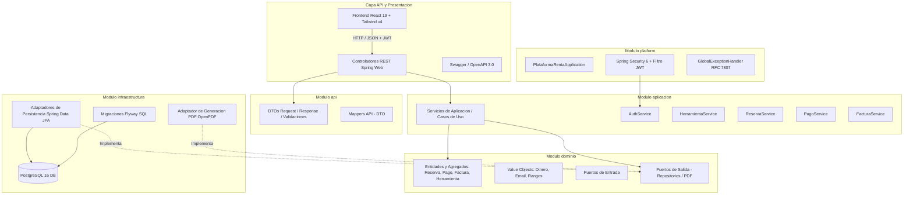
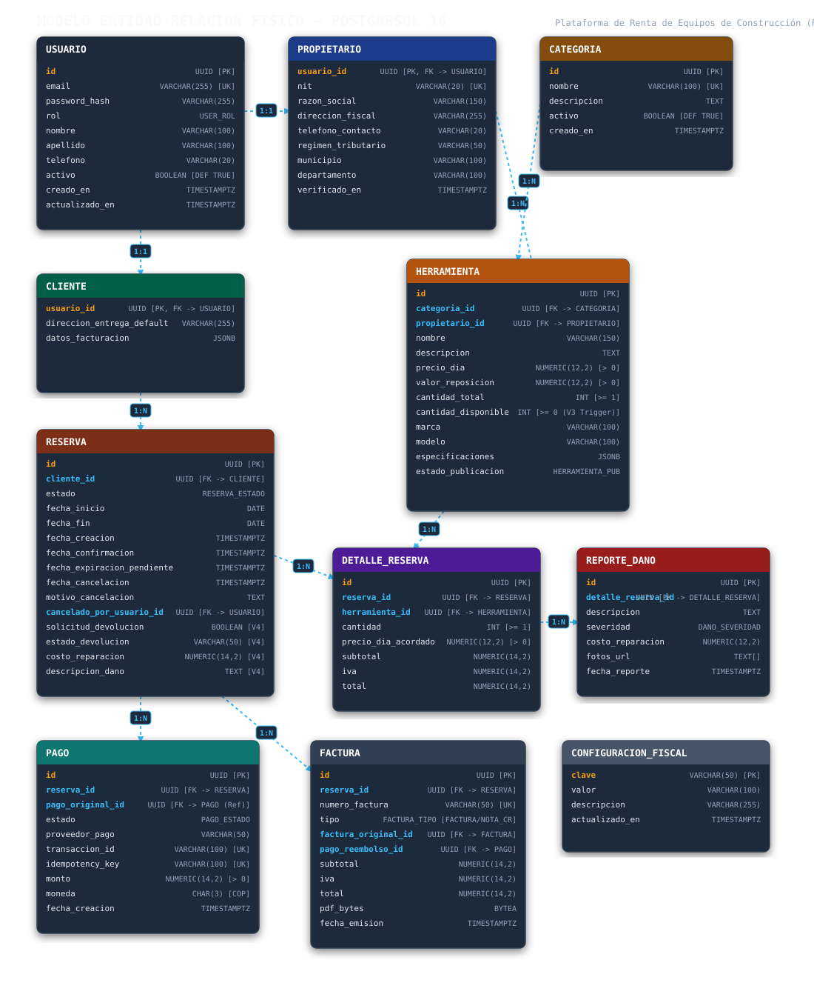
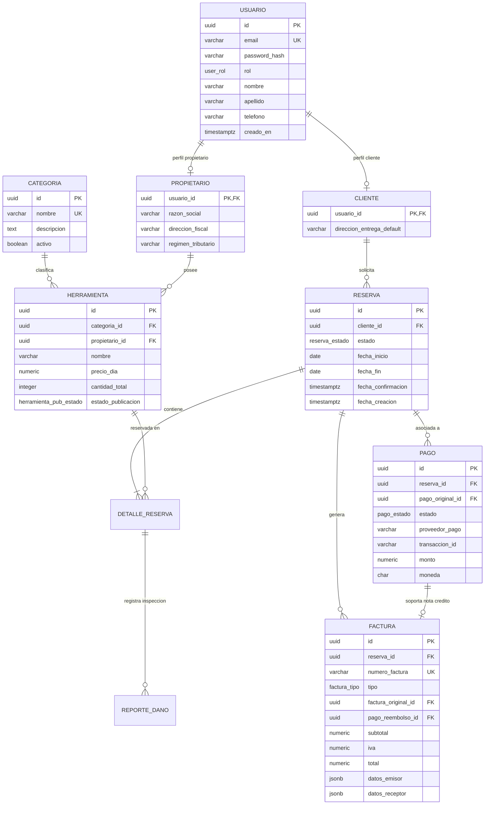

# Plataforma de Renta de Herramientas y Equipos de Construcción

> **Proyecto Académico de Ingeniería de Software**
> **Backend:** Java 21 + Spring Boot (Maven Multimódulo, Arquitectura Hexagonal / DDD)
> **Frontend:** React 19 + TypeScript + Vite + Tailwind CSS v4
> **Base de Datos:** PostgreSQL 16 con migraciones automatizadas Flyway
> **Documentación de API:** OpenAPI 3 / Swagger UI y Colección Postman v2.1

---

## 1. Descripción del Proyecto

La **Plataforma de Renta de Herramientas y Equipos de Construcción** es una solución web empresarial integral diseñada para la gestión, reserva, despacho, facturación y control de maquinaria y herramientas en el sector constructor.

El sistema resuelve la problemática de inventarios desarticulados, sobreventa (overbooking) y falta de trazabilidad en las operaciones de alquiler de maquinaria pesada, liviana y eléctrica, conectando a:
1. **Clientes (Constructoras / Contratistas):** Quienes exploran el catálogo unificado, verifican la disponibilidad de inventario en rangos temporales específicos, gestionan sus reservas y descargan sus facturas en PDF.
2. **Propietarios (Empresas de Maquinaria):** Quienes publican su parque de herramientas, aceptan o rechazan solicitudes, despachan los equipos y realizan la recepción técnica tras inspección de daños.
3. **Administradores:** Quienes supervisan la plataforma global, monitorean métricas de negocio e ingresos, administran cuentas de usuario y aprueban reembolsos.

---

## 2. Arquitectura de Software

La solución implementa una **Arquitectura Hexagonal (Puertos y Adaptadores)** combinada con principios de **Domain-Driven Design (DDD)**, estructurada en un proyecto Maven multimódulo.

### Diagrama de Arquitectura Hexagonal



### Módulos Maven y Responsabilidades

| Módulo | Tipo | Responsabilidad Arquitectónica | Dependencias Permitidas |
| :--- | :--- | :--- | :--- |
| **`domain`** | Java Puro | Núcleo del negocio: Entidades (`Reserva`, `Pago`, `Factura`, `Herramienta`), Enums (`ReservaEstado`, `PagoEstado`), Value Objects (`Dinero`, `Email`) y Puertos (`*Repository`, `FacturaPdfPort`). | Ninguna dependencia externa de frameworks. |
| **`application`** | Java / Spring Core | Casos de uso y orquestación del dominio (`ReservaService`, `PagoService`, `FacturaService`, etc.). | Depende únicamente de `domain`. |
| **`infrastructure`** | Spring Data JPA / OpenPDF | Adaptadores que implementan los puertos de salida: mapeo relacional a PostgreSQL, consultas SQL optimizadas y renderizado de facturas PDF. | Depende de `domain` y `application`. |
| **`api`** | Spring Web | Controladores REST, DTOs de entrada/salida y validación `@Valid` según estándares OpenAPI 3. | Depende de `application` y `domain`. |
| **`platform`** | Spring Boot Packaging | Punto de entrada `@SpringBootApplication`, configuración de Spring Security, filtro JWT, variables de entorno y pruebas de arquitectura ArchUnit. | Integra todos los módulos anteriores. |

---

## 3. Modelo de Datos PostgreSQL

El esquema relacional fue diseñado específicamente para PostgreSQL 16 con tipos enumerados nativos, restricciones de integridad referencial, disparadores de inmutabilidad financiera y cálculos de disponibilidad no bloqueantes.

### Diagrama Entidad-Relación (ER)

> **Exportación Visual Gráfica Oficial:** El diagrama físico relacional se encuentra exportado en formato vectorial de alta resolución en [`docs/diagrama_er.svg`](docs/diagrama_er.svg).  
> **Archivo Fuente Editable:** Disponible en [`docs/diagrama_er.mmd`](docs/diagrama_er.mmd).





### Reglas de Integridad y Triggers Destacados

1. **Inmutabilidad de Pagos Completados (`trg_pago_completado_inmutable`):**
   Impide que registros en tabla `pago` con estado `COMPLETADO` sean alterados en su monto, moneda o reserva asociada.
2. **Consistencia de Notas de Crédito (`validar_nota_credito_original` y `validar_nota_credito_reembolso_factura`):**
   Verifica que una factura de tipo `NOTA_CREDITO` referencie una `FACTURA` previa válida de la misma reserva y un pago en estado `REEMBOLSADO`.
3. **Idempotencia de Pagos (`uq_pago_completado_por_reserva`):**
   Índice único condicional que garantiza a nivel de motor que jamás exista más de un cobro completado para una misma reserva.
4. **Segregación de Roles y Registro Seguro:**
   Control estricto de roles en el registro y en tiempo de ejecución (`ROLE_CLIENTE`, `ROLE_PROPIETARIO`, `ROLE_ADMIN`). Los endpoints de administración y de creación de usuarios con privilegios elevados están restringidos exclusivamente al rol `ADMIN`.

---

## 4. Flujos de Negocio Principales

### A. Autenticación y Autorización
- Registro y autenticación mediante JWT (`HMAC-SHA256`).
- Autorización basada en roles (`ROLE_CLIENTE`, `ROLE_PROPIETARIO`, `ROLE_ADMIN`) protegida a nivel de endpoints con Spring Security y anotaciones `@PreAuthorize`.

### B. Catálogo y Disponibilidad Temporal
- Consulta de herramientas por categoría.
- Verificación de disponibilidad en tiempo real:
  $$\text{Disponibles} = \text{Total} - \sum \text{Cantidad en reservas solapadas activo (PENDIENTE, CONFIRMADA, EN\_CURSO)}$$
- Prevención estricta de sobrecupo (HTTP 409 Conflict si la cantidad solicitada supera el stock para el rango de fechas).

### C. Ciclo de Vida de la Reserva
```text
[PENDIENTE] --(Propietario Acepta)--> [CONFIRMADA] --(Propietario Entrega)--> [EN_CURSO] --(Devolución con Inspección)--> [FINALIZADA]
     |                                      |
(Rechazo/Expiración)                   (Cancelación)
     v                                      v
 [RECHAZADA / EXPIRADA]                [CANCELADA]
```

### D. Pasarela Simulada, Facturación e Idempotencia
- **Simulación de Pago:** Procesa el abono mediante pasarela simulada con control de clave de idempotencia (`claveIdempotencia`). Peticiones repetidas retornan la transacción existente sin generar cobros duplicados.
- **Cálculo Tributario:** Aplica el 19% de IVA según normativa comercial colombiana.
- **Generación de Factura PDF:** Genera en memoria un documento binario PDF estándar con metadatos tributarios (emisor, receptor, desglose de ítems, subtotal, IVA y total) mediante el motor OpenPDF.

### E. Reembolsos y Notas de Crédito
- El cliente titular solicita un reembolso sobre una reserva pagada.
- El propietario o administrador evalúa y aprueba el reembolso.
- Al aprobarse, el pago transiciona a `REEMBOLSADO` y se emite automáticamente una **Nota de Crédito** formal referenciando la factura original.

---

## 5. Retirada Definitiva de Express y Unificación en Spring Boot

El proyecto sustituyó por completo el prototipo basado en Express.js (`server.ts`), consolidando la totalidad de la lógica en Spring Boot:

- **Eliminación:** Se retiró el archivo `server.ts` y las dependencias Node redundantes (`express`, `@types/express`, `tsx`, `jsonwebtoken`, `bcryptjs`, `jspdf`, `@google/genai`).
- **Frontend Independiente:** React 19 + TypeScript + Vite opera como cliente SPA estricto comunicándose exclusivamente mediante `fetch` con los endpoints REST del backend Spring Boot.
- **Comprobación:** Build de producción de Vite exitoso en `< 1s` y comprobación estricta de tipos `tsc --noEmit` con 0 errores.

---

## 6. Variables de Entorno y Configuración

El backend se configura mediante variables de entorno estándar. No se versionan credenciales reales en el repositorio.

| Variable | Descripción | Valor Local por Defecto |
| :--- | :--- | :--- |
| `SERVER_PORT` | Puerto de escucha del servidor HTTP | `8080` |
| `DB_URL` | URL JDBC de conexión a PostgreSQL | `jdbc:postgresql://localhost:5439/plataforma_renta` |
| `DB_USERNAME` | Usuario de base de datos | `postgres` |
| `DB_PASSWORD` | Contraseña de base de datos | `postgres` |
| `JWT_SECRET` | Clave secreta para firma HMAC de tokens (mínimo 32 bytes) | `clave-secreta-de-prueba-de-32-bytes-minimo-para-testing` |
| `VITE_API_URL` | URL base consumida por el frontend | `http://localhost:8080/api/v1` |

> **Aislamiento de Puertos:** PostgreSQL está configurado en el puerto `5439` para evitar colisiones con instancias locales estándar en `5432`. El frontend soporta indistintamente los puertos `5173` y `5174` gracias a la política CORS para orígenes locales (`http://localhost:*`).

---

## 7. Instrucciones de Ejecución y Conexión

> Consulta también la guía de inicio detallada en [`docs/GUIA_INICIO_Y_CONEXIONES.md`](docs/GUIA_INICIO_Y_CONEXIONES.md).

### Prerrequisitos
- **Java:** OpenJDK 21 o superior.
- **Maven:** Apache Maven 3.9+.
- **Node.js:** Versión 20+ y `npm`.
- **PostgreSQL / Docker:** Contenedor PostgreSQL 16 activo.

### 1. Iniciar Base de Datos con Docker Compose
```bash
# Copiar variables de entorno base
cp .env.example .env

# Iniciar contenedor PostgreSQL 16 Alpine en segundo plano
docker compose up -d

# Verificar estado saludable (healthy)
docker compose ps
```

### 2. Conexión desde Clientes SQL (DBeaver, DataGrip, pgAdmin)
Para visualizar o consultar las tablas relacionales:
- **Tipo:** PostgreSQL
- **Host:** `localhost` (o `127.0.0.1`)
- **Puerto:** `5439` *(no usar 5432)*
- **Base de Datos:** `plataforma_renta`
- **Usuario:** `postgres`
- **Contraseña:** `postgres`
- **Esquema:** `public` (12 tablas del dominio: `usuario`, `cliente`, `propietario`, `categoria`, `herramienta`, `reserva`, `detalle_reserva`, `pago`, `factura`, `configuracion_fiscal`, `reporte_dano`, `flyway_schema_history`).

### 3. Procedimiento de Despliegue y Arquitectura Tomcat

La plataforma está diseñada según los estándares modernos de arquitectura de microservicios y despliegue en la nube:

1. **Despliegue Predeterminado (Tomcat Embebido 10.1):**  
   Empaquetado en un archivo JAR autocontenido y ejecutable mediante `spring-boot-starter-tomcat`. Es la modalidad estándar de producción, pues elimina dependencias del servidor anfitrión, garantiza la compatibilidad de versiones de servlet (Jakarta EE 10 / Servlet 6.0) y facilita la contenerización en Docker / Kubernetes.
   ```bash
   mvn clean package -DskipTests
   java -jar platform/target/platform-0.1.0-SNAPSHOT.jar
   ```

2. **Despliegue como WAR en Servidor Tomcat Externo (Opcional):**  
   Si la infraestructura educativa o corporativa exige desplegar sobre una instancia existente de Apache Tomcat (versión 10.1 o superior compatible con Java 21 y Jakarta EE):
   - Cambiar en `platform/pom.xml`: `<packaging>war</packaging>`.
   - Marcar la dependencia de Tomcat como provista:
     ```xml
     <dependency>
         <groupId>org.springframework.boot</groupId>
         <artifactId>spring-boot-starter-tomcat</artifactId>
         <scope>provided</scope>
     </dependency>
     ```
   - La clase principal `PlataformaRentaApplication` hereda de `SpringBootServletInitializer` y sobrescribe `configure(SpringApplicationBuilder application)`.
   - Copiar el archivo `.war` generado en el directorio `webapps/` de Tomcat.

### 4. Compilar y Ejecutar el Backend (Spring Boot)
```bash
# Compilar todo el proyecto Maven multimódulo
mvn clean package -DskipTests

# Ejecutar la aplicación Spring Boot con sus variables de entorno
DB_URL="jdbc:postgresql://localhost:5439/plataforma_renta" \
DB_USERNAME="postgres" \
DB_PASSWORD="postgres" \
JWT_SECRET="clave-secreta-de-prueba-de-32-bytes-minimo-para-testing" \
SERVER_PORT="8080" \
java -jar platform/target/platform-0.1.0-SNAPSHOT.jar
```
Al iniciar, Flyway aplicará automáticamente las migraciones `V1` y `V2` inicializando el esquema y las categorías semilla.

### 4. Iniciar el Frontend (React 19 + TypeScript + Vite)
```bash
cd frontend
npm install

# Iniciar servidor de desarrollo en puerto 5174 (evita conflicto con 5173 si está ocupado)
npm run dev -- --port 5174
```
La interfaz estará disponible en: **`http://localhost:5174`** (o `http://localhost:5173`).

---

## 8. Cuentas de Demostración para Evaluación y Sustentación

Para los ensayos, sustentación y pruebas del sistema, la base de datos se inicializa con el script reproducible [`database/seed_demo.sql`](database/seed_demo.sql) (`docker compose exec -i postgres psql -U postgres -d plataforma_renta < database/seed_demo.sql`):

| Rol | Correo Electrónico | Contraseña Demostración | Perfil / Catálogo Asociado |
| :--- | :--- | :--- | :--- |
| **ADMIN** | `admin@obrixen.com.co` | `AdminDemo2026*!` | Panel administrativo global, gestión de usuarios y métricas. |
| **CLIENTE** | `cliente@obrixen.com.co` | `ClienteDemo2026*!` | Andrés Restrepo (Constructora Restrepo SAS) con dirección de entrega. |
| **PROPIETARIO 1** | `propietario1@obrixen.com.co` | `Propietario1Demo2026*!` | Maquinaria y Equipos Andina S.A.S. (Bogotá) — 8 herramientas. |
| **PROPIETARIO 2** | `propietario2@obrixen.com.co` | `Propietario2Demo2026*!` | Soluciones de Energía y Andamios del Valle S.A.S. (Cali) — 8 herramientas. |
| **PROPIETARIO 3** | `propietario3@obrixen.com.co` | `Propietario3Demo2026*!` | Equipos Eléctricos y Menores de Antioquia Ltda. (Medellín) — 8 herramientas. |

> **Registro de Nuevos Usuarios:** Puedes crear usuarios nuevos con rol `CLIENTE` o `PROPIETARIO` desde la pantalla de Registro o mediante la API (sin requerir NIT). El rol `ADMIN` está protegido contra registro público por reglas de seguridad.

---

## 9. Documentación de API y Colección Postman

### Swagger / OpenAPI 3.0
Con el backend en ejecución, acceda a la documentación interactiva y especificación OpenAPI en:
- **Swagger UI:** `http://localhost:8080/swagger-ui/index.html` (Incluye botón **Authorize** para autenticación `Bearer <token>` y endpoints públicos debidamente desmarcados).
- **OpenAPI JSON Spec:** `http://localhost:8080/v3/api-docs` (Esquema de seguridad `bearerAuth` HTTP Bearer JWT).

### Colección Postman
En la carpeta [`docs/postman_collection.json`](docs/postman_collection.json) se encuentra la colección oficial compatible con Postman v2.1. Incluye scripts automáticos para guardar tokens JWT en variables de colección y cubre:
1. Autenticación (Registro y Login de roles).
2. Catálogo de equipos y comprobación de disponibilidad.
3. Creación y flujo de estados de reservas.
4. Procesamiento de pagos con idempotencia y descarga binaria de facturas PDF.
5. Solicitud y resolución de reembolsos con notas de crédito.
6. Dashboard de métricas y administración de usuarios.

---

## 10. Pruebas Automatizadas

El proyecto cuenta con un conjunto integral de pruebas automatizadas:

```bash
# Ejecutar todas las pruebas del backend (unitarias, integración y arquitectura)
mvn test
```

- **Pruebas Unitarias de Dominio:** Modelado de entidades ricas, operaciones financieras con `Dinero` y transiciones seguras de estados de `Reserva`.
- **Pruebas de Casos de Uso (Mockito):** Verificación de idempotencia, orquestación de pagos, facturas y notas de crédito.
- **Pruebas de Integración con Testcontainers:** Verificación de concurrencia y transacciones sobre PostgreSQL real en contenedor Docker.
- **Pruebas de Arquitectura (ArchUnit):** Reglas hexagonales que prohíben que el dominio importe infraestructura o frameworks.
- **Frontend Check:**
  ```bash
  cd frontend
  npm run lint   # Verificación estricta de tipos TypeScript
  npm run build  # Compilación de bundles de producción Vite
  ```

---

## 11. Aviso Legal y Alcance Normativo

> **IMPORTANTE — ALCANCE DE LA FACTURACIÓN DEL PROYECTO:**
> Los documentos PDF de facturas y notas de crédito emitidos por esta plataforma constituyen **comprobantes comerciales y tributarios simulados con propósitos académicos y de demostración funcional**.
> Esta implementación **no constituye por sí misma una Factura Electrónica de Venta validada previamente por la DIAN** en los términos del Estatuto Tributario colombiano ni del Decreto 358 de 2020. No incluye firma digital con certificado X.509 de un Proveedor Tecnológico Autorizado, generación de CUFE (Código Único de Factura Electrónica), código QR DIAN ni transmisión sincrónica mediante Web Services SOAP/XML a la autoridad tributaria.
